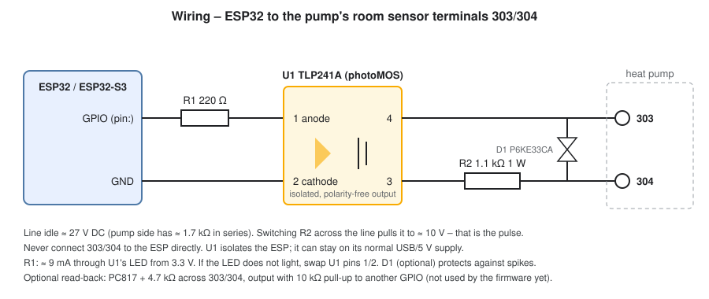
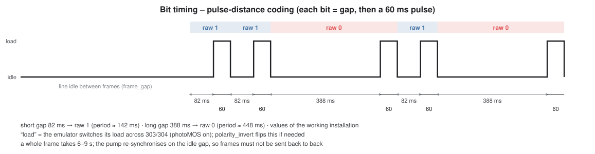
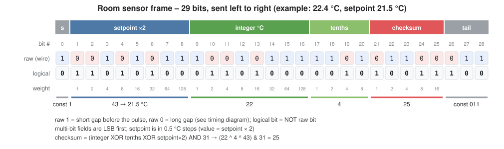

# Thermia / Danfoss room sensor emulator for ESPHome

[](https://buymeacoffee.com/mdepa91)

An ESPHome external component that turns an ESP32 into the **room sensor** of a Thermia or Danfoss ground-source
heat pump. The ESP talks to the pump over the room sensor terminals **303/304**, the same way the original sensor
does. The pump then regulates on the room temperature you feed it, for example from a Zigbee sensor in Home
Assistant, and on a room setpoint you control from Home Assistant.

Without a room sensor the pump only guesses the room temperature from its heating curve. With one, it shifts the
curve on the fly to hold the setpoint. The room factor setting decides how strongly it reacts.

**Status:** working on a Thermia heat pump since 2026-10. The pump accepts the frames, clears the room sensor
alarm, shows the temperature and uses the setpoint.

**Dashboard:** [thermia-heatpump-card](https://github.com/mdepa91/ha-thermia-heatpump-card) is a Lovelace card that draws the whole pump
and has − / + buttons for this setpoint. The component publishes a *Thermia room card map* entity, so the card finds
the room temperature and the setpoint after you pick the ESPHome device.

> **Tested on:** ESP32-S3, ESPHome 2026.9.1, running next to [esphome-thermia](https://github.com/mdepa91/esphome-thermia)
> on the same board – see [Using it with esphome-thermia](#using-it-with-esphome-thermia).

## Features

| Entity | Range | What the pump does with it |
|---|---|---|
| `room_temperature` | 0.0–31.9 °C, 0.1 °C steps | Uses it as the actual indoor temperature (EXT register r01/r02) |
| `setpoint` | 16.0–31.5 °C, 0.5 °C steps (adjustable) | Uses it as the indoor target (r03/r04), instead of its own HUONE / r32 setting |

- The room temperature and the setpoint are stored in flash and restored after a reboot, so the pump keeps getting
  sensible values even before Home Assistant reconnects. They are written only when they actually change.
- If the pump stops receiving valid frames, it raises the room sensor alarm after a while and falls back to its own
  setpoint (r32).
- Only the sensor → pump direction is implemented. The original sensor has a display and probably also receives
  data from the pump, but the pump does not need that to accept the readings.

### Compatibility

The room sensor port and protocol are shared by heat pumps with the Danfoss/Thermia controller of that era:
- Thermia Diplomat, Diplomat Optimum, Duo, Legend;
- Danfoss DHP-H / DHP-C / DHP-L.

The original sensor for these pumps is **086U6003**, sold as a Thermia or Danfoss room sensor. It has an LCD and
buttons. Newer Thermia iTec / Atec / Calibra pumps use a different bus (RS485) and are not supported.

The component needs an **ESP32-family chip** because it uses the RMT peripheral to time the pulses in hardware. It
works on ESP32, ESP32-S2, -S3 and -C3, with either the ESP-IDF or the Arduino framework.

## Hardware



| Part | Value | Role |
|---|---|---|
| U1 | Toshiba **TLP241A** photoMOS relay (DIP-4) | Switches the load across 303/304. Isolated, polarity-free output, 40 V |
| R1 | 220 Ω | LED current for U1 (about 9 mA from 3.3 V) |
| R2 | 1.1 kΩ, 1 W | The load that makes a pulse |
| D1 | P6KE33CA TVS (optional) | Spike protection across 303/304 |

The line idles at **about 27 V DC** and has about 1.7 kΩ in series on the pump side. Switching R2 across it pulls
it down to about 10 V; that is a pulse. **Never connect 303/304 to the ESP directly.** The photoMOS isolates the
ESP, so it can stay on its normal USB / 5 V supply.

Check your pump's manual for the room sensor terminals. On most models they are **303 and 304**, often drawn as
component 406 ("room sensor") in the wiring diagram.

## Configuration

```yaml
external_components:
  - source: github://mdepa91/esphome-thermia-room
    components: [thermia_room]

thermia_room:
  pin: GPIO10
  room_temperature:
    name: "Room temperature (emulated)"
  setpoint:
    name: "Room setpoint"
```

Then feed `room_temperature` from your real room sensor – with a Home Assistant automation that calls
`number.set_value`, or directly on the ESP (see [Setting the room temperature](#setting-the-room-temperature)).
A complete configuration is in [`example.yaml`](example.yaml).

| Option | Default | Description |
|---|---|---|
| `pin` | (required) | GPIO driving the photoMOS LED |
| `mark_us` | `60000` | Pulse width in µs |
| `space_short_us` | `82000` | Gap before a pulse for a raw 1 |
| `space_long_us` | `388000` | Gap before a pulse for a raw 0 |
| `frame_gap` | `4s` | Idle time between frames. The pump syncs on it: 2–4 s works, 0 does not |
| `polarity_invert` | `false` | Invert the pin, if your driver stage loads the line on LOW |
| `dry_run` | `false` | Only log the frames, do not drive the pin |
| `update_interval` | `10s` | How often the entities are republished |
| `room_temperature`, `setpoint` | | Optional [number](https://esphome.io/components/number/) entities |
| `transmit` | | Optional diagnostic [switch](https://esphome.io/components/switch/) that turns the frames on and off, e.g. while checking the wiring. Off leaves the line idle, as if no room sensor were connected: the pump raises the room sensor alarm and regulates to its fallback setpoint (r32). A frame already on the wire is finished first. Restored at boot, on by default (`restore_mode`). To stop the pump using the room sensor in normal operation, set the room factor to 0 instead (see [Using it with esphome-thermia](#using-it-with-esphome-thermia)) |
| `setpoint` → `min_value` | `16` | Lowest setpoint offered and sent. The pump raises the room sensor alarm below 16 °C |
| `setpoint` → `max_value` | `31.5` | Highest setpoint offered and sent |
| `card_map` | name: *Thermia room card map* | Diagnostic select listing `room_temperature=` / `setpoint=` / `transmit=` with the entity names, so [thermia-heatpump-card](https://github.com/mdepa91/ha-thermia-heatpump-card) can pick the entities by itself once you choose this device. Read-only; `internal: true` hides it from Home Assistant. |

The setpoint range only limits what the entity accepts. A value restored from flash that is outside the range is
clamped into it at boot. The frame itself can carry 5–35 °C, so you can widen the range if your pump accepts more,
or narrow it to keep the slider sensible:

```yaml
thermia_room:
  pin: GPIO10
  room_temperature:
    name: "Room temperature (emulated)"
  setpoint:
    name: "Room setpoint"
    min_value: 18      # default 16 – below 16 °C the pump raises the room sensor alarm
    max_value: 24      # default 31.5
```

**Do not rename entities in YAML** once they are in Home Assistant. ESPHome derives the entity ID from `name:`, so a
rename creates a new entity and loses its history. Change the display name in Home Assistant instead.

### Setting the room temperature

`room_temperature` and `setpoint` are ordinary [number](https://esphome.io/components/number/) entities. Give them an
`id` and set them with the `number.set` action, from any sensor or lambda, without a Home Assistant automation:

```yaml
thermia_room:
  pin: GPIO16
  room_temperature:
    id: room_temp
    name: "Room temperature (emulated)"

sensor:
  # A room sensor from Home Assistant (e.g. Zigbee) – forwarded on every change
  - platform: homeassistant
    id: ha_room_temp
    entity_id: sensor.living_room_temperature
    on_value:
      - number.set:
          id: room_temp
          value: !lambda 'return x;'

interval:
  # Or any computed value – here once a minute, keeping the last value while Home Assistant is unavailable
  - interval: 60s
    then:
      - number.set:
          id: room_temp
          value: !lambda |-
            float t = id(ha_room_temp).state;
            return std::isnan(t) ? id(room_temp).state : t;
```

A sensor wired to the ESP itself (DS18B20, BME280, …) works the same way – call `number.set` in its `on_value`, and
the pump gets the room temperature even without Home Assistant. From C++ in a lambda:
`id(room_temp).make_call().set_value(21.5).perform();`.

- Values are clamped to 0.0–31.9 °C and rounded to 0.1 °C. A new value goes out with the next frame, within about
  10–12 s. NaN (e.g. an unavailable Home Assistant sensor) is ignored and the last value is kept.
- Both values are written to flash only when they change. ESPHome batches the writes (`preferences:
  flash_write_interval`, default 1 min), so even a sensor that changes every few seconds costs at most one write per
  minute.

## Using it with esphome-thermia

This component only **talks to** the pump: it sends a room temperature and a setpoint, and the room sensor port
gives no feedback. To see what the pump does with those values, and to change its other settings, add the
[esphome-thermia](https://github.com/mdepa91/esphome-thermia) component. It reads and writes the pump's
registers over the separate **EXT** connector (I2C). Both run fine on one ESP32:

| | `thermia_room` (this component) | `thermia` ([esphome-thermia](https://github.com/mdepa91/esphome-thermia)) |
|---|---|---|
| Connector | Room sensor terminals 303/304 | EXT connector (I2C, 5 V – needs a level shifter) |
| Direction | ESP → pump | ESP ↔ pump (pump is the I2C master) |
| Sends | room temperature, setpoint | writes to settings: fallback setpoint (r32), room factor, curve, mode, … |
| Reads | – | indoor temperature and target as the pump sees them (r01–r04), room sensor alarm, everything else |

What the two do together:
- **Feedback loop:** set `room_temperature` / `setpoint` here, then check with `temp_indoor` / `temp_indoor_target`
  (r01–r04, with tenths) that the pump took them over.
- **Alarm:** `alarm_indoor_sensor` (r14 bit 4) turns on when the pump stops accepting room sensor frames, for example
  when the ESP is offline or the wiring is wrong.
- **Fallback setpoint:** while that alarm is on, or while the room factor is 0, the pump regulates to its own
  setpoint, `setting_indoor_temp` (r32). Keep it at a sensible value, because it takes over whenever the emulated
  sensor drops out. While the sensor works and the room factor is above 0, the pump ignores it and uses `setpoint`
  from this component.
- **Room factor:** `setting_room_factor` (r3C, 0–4) sets how strongly the room temperature corrects the heating
  curve. **0 switches the room sensor off:** according to the pump manual, the pump then takes r32 as its target
  and only displays the room temperature, without raising an alarm. This is the clean way to stop using the room
  sensor for a while; set 1–4 again to bring it back. `temp_indoor_target` (r03) shows which target is in use.
  The diagnostic `transmit` switch also takes the sensor away, but the pump sees that as a fault and raises the
  room sensor alarm.

Complete configuration: [`example-with-thermia.yaml`](example-with-thermia.yaml). The relevant parts:

```yaml
external_components:
  - source: github://mdepa91/esphome-thermia-room
    components: [thermia_room]
  - source: github://mdepa91/esphome-thermia
    components: [thermia]

esp32:
  variant: esp32s3

thermia_room:
  pin: GPIO10                          # TLP241A on 303/304
  room_temperature:
    name: "Room temperature (emulated)"
  setpoint:
    name: "Room setpoint"

thermia:
  sda_pin: GPIO12                      # EXT via level shifter
  scl_pin: GPIO11
  temp_indoor:
    name: "Indoor temperature (pump)"
  temp_indoor_target:
    name: "Indoor target (pump)"
  alarm_indoor_sensor:
    name: "Alarm: room sensor"
  setting_indoor_temp:
    name: "Fallback setpoint (without room sensor)"
  setting_room_factor:
    name: "Room factor"
```

Pin choice: on an ESP32 the `thermia` pins must be GPIO0–31 (see its README). `thermia_room` can use any output
pin.

## Protocol

Everything below was reverse-engineered. Thermia never published it. See [Credits](#credits).

### Bits: pulse-distance coding



- Every bit is a **gap** (line idle) followed by a **60 ms pulse** (line loaded). The length of the gap *before* a
  pulse carries that pulse's bit: about 82 ms means raw 1, about 388 ms means raw 0.
- A frame is 29 bits and takes 6–9 s. Frames are separated by an idle gap of a few seconds. **The pump finds the
  start of a frame by that gap.** Frames sent back to back make it lose sync and decode garbage, for example a room
  temperature of 92 or 242 °C.

### Frame



```
start(1) | setpoint × 2 (8) | integer °C (8) | tenths (4) | checksum (5) | tail(3)
   1     |  0.5 °C steps    |     0–31       |    0–9     |              |  011
```

- **Logical bit = NOT raw bit.** Multi-bit fields are sent **LSB first**.
- **Setpoint** is in half degrees: 21.0 °C is sent as 42.
- **Integer** is 8 bits wide. Its top 3 bits are 0 for every valid temperature, which made them look like a
  constant marker for a long time.
- **Checksum** = `(integer XOR tenths XOR setpoint×2) AND 31`. The pump checks it and **silently drops** frames that
  fail. One bad frame does not raise an alarm; only a longer absence of good frames does.

Examples from the encoder (`raw` is what goes on the wire, `I` = short gap + pulse, `_I` = long gap + pulse):

| Room | Setpoint | Raw bits (start \| setpoint \| integer \| tenths \| checksum \| tail) | Waveform |
|---|---|---|---|
| 20.5 °C | 21.0 °C | `1 \| 10101011 \| 11010111 \| 0101 \| 00100 \| 011` | `II_II_II_IIIII_II_IIII_II_II_I_II_I_I_III` |
| 22.4 °C | 21.5 °C | `1 \| 00101011 \| 10010111 \| 1101 \| 01100 \| 011` | `I_I_II_II_IIII_I_II_IIIIII_II_III_I_I_III` |

The first row matches, bit for bit, the debug output of the reference implementation this work started from.

### What the pump reports back

With [esphome-thermia](#using-it-with-esphome-thermia) you can watch the effect of the frames in the pump's
registers:

| Register | Meaning |
|---|---|
| r01 / r02 | Indoor temperature, whole degrees / tenths. Follows `room_temperature` |
| r03 / r04 | Indoor target used by the pump. Follows `setpoint` while the sensor is OK |
| r32 | The pump's own setpoint (HUONE). Used while the room sensor has an alarm or the room factor is 0 |
| r14 bit 4 | Room sensor alarm |
| r3C | Room factor (0–4). How strongly the room temperature corrects the supply temperature; 0 = room sensor off, r32 is the target |

## Development

The frame encoder has no hardware dependencies and a host test. It covers the author's notes, the line captures,
the setpoints confirmed on the pump, and round trips over all values:

```sh
g++ -std=c++17 -Wall -I components/thermia_room components/thermia_room/thermia_room_frame.cpp \
    test/test_room_frame.cpp -o test/test_room_frame && ./test/test_room_frame
```

CI runs this test and compiles both example configurations on every push.

Files:
- `components/thermia_room/thermia_room_frame.*`: frame encoder and decoder;
- `components/thermia_room/thermia_room.*`: RMT line driver and entities;
- `docs/*.svg`: the diagrams in this README;
- `docs/room_sensor_context.md`: full research log, in Polish;
- `docs/CONTEXT.md`: summary for continuing the work, in Polish.

### How the format was found

1. A blog post by rainisto gave the bit encoding, a 20.5 °C debug string, two line captures (20.1 / 20.2 °C) and a
   hand-written table of bit patterns. Decoding those fixed the temperature fields and the checksum, assuming the
   setpoint was 21.0.
2. A real pump accepted the emulated frames and showed the temperature, but its target stayed at 21 °C. The bits
   that looked like a constant preamble turned out to be the setpoint.
3. Changing the setpoint made the pump drop the frames, because the checksum was wrong. A brute-force run tried all
   32 checksums for setpoints 19, 20, 22 and 23 °C, interleaved with valid frames so the sensor stayed alive. The
   pump accepted exactly one checksum for each setpoint. All four confirmed the formula above, and three of them
   had been predicted before the run.

## Credits

- **rainisto (Jonni)**: the original reverse engineering of the room sensor protocol and the EXT/I2C protocol.
  Blog: [omakotikotitalomme.blogspot.com](https://omakotikotitalomme.blogspot.com/2024/01/danfoss-sisalampotilasensorin.html),
  code: [arduino_i2c_orja](https://github.com/rainisto/arduino_i2c_orja).
- **[ThermIQ](https://www.thermiq.net)**: register map and the ThermIQ-ROOM2 product, which is what the captured
  frames came from.
- [maalampofoorumi.fi](https://www.maalampofoorumi.fi/index.php?topic=2246.0): details of the original 086U6003
  sensor (display, buttons, 0.5 °C setpoint steps).
